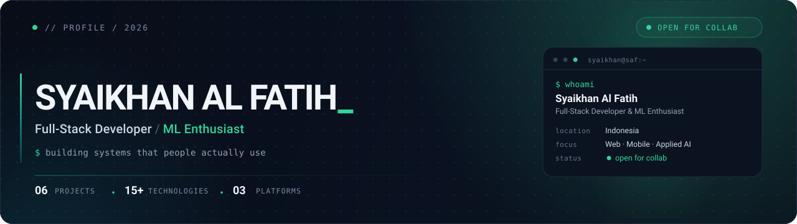

  

  <a href="https://syaikhanalfatih-ops.github.io"><b>portfolio</b></a>
  &nbsp;·&nbsp;
  <a href="mailto:syaikhanalfatih@gmail.com"><b>email</b></a>
  &nbsp;·&nbsp;
  <a href="https://github.com/syaikhanalfatih-ops"><b>github</b></a>

## // whoami

**Syaikhan Al Fatih** — full-stack developer yang membangun sistem web dan mobile
yang rapi, aman, dan benar-benar dipakai. Bukan sekadar demo yang jalan di laptop.

- **Fokus** — Web · Mobile · Applied AI
- **Lokasi** — Indonesia
- **Status** — ● open for collaboration
- **Lagi** — arsitektur full-stack, computer vision, dan ML terapan

> “Kode boleh kompleks di belakang, tapi pengalaman pengguna harus terasa sederhana.”

## // stack

**Frontend** 

**Backend & database** 

**Mobile & PWA** 

**Applied AI & ML** 

Tools — Git & GitHub · VS Code · XAMPP · Android SDK · Postman

## // featured work

| Proyek | Tentang | Stack |
|:--|:--|:--|
| **[Pustaka Cerdas](https://github.com/syaikhanalfatih-ops/pustaka_cerdas)** | Perpustakaan digital sekolah — katalog, sirkulasi, QR/barcode, dan rekomendasi buku. | `PHP` `MySQL` `PWA` |
| **[Absensi AI](https://github.com/syaikhanalfatih-ops/absensi-app)** · [demo](https://absensi-app-pink.vercel.app) | Presensi PWA dengan face recognition on-device, geofencing, dan QR dinamis. | `Node.js` `Express` `Face API` |
| **[Roblox Store](https://github.com/syaikhanalfatih-ops/roblox-store)** · [demo](https://roblox-store-ten.vercel.app) | Top-up Roblox dengan QRIS otomatis, invoice realtime, dan dashboard admin. | `Next.js` `TypeScript` `Prisma` |
| **Kasir POS Hybrid** · [detail](https://syaikhanalfatih-ops.github.io/#proyek) | POS dengan REST API, dashboard React, dan aplikasi kasir React Native. | `React` `React Native` `PostgreSQL` |

→ Lihat semua proyek beserta catatan teknisnya di <a href="https://syaikhanalfatih-ops.github.io">portfolio</a>.

## // github stats

  
  

  

## // connect

Terbuka untuk kolaborasi, proyek freelance, atau diskusi soal web, mobile, dan AI terapan.

  
  
  

  “Teknologi terbaik itu yang bikin orang lupa kalau sedang pakai teknologi.”
   
  Syaikhan Al Fatih · 2026 · dibangun pelan-pelan dengan rasa penasaran

